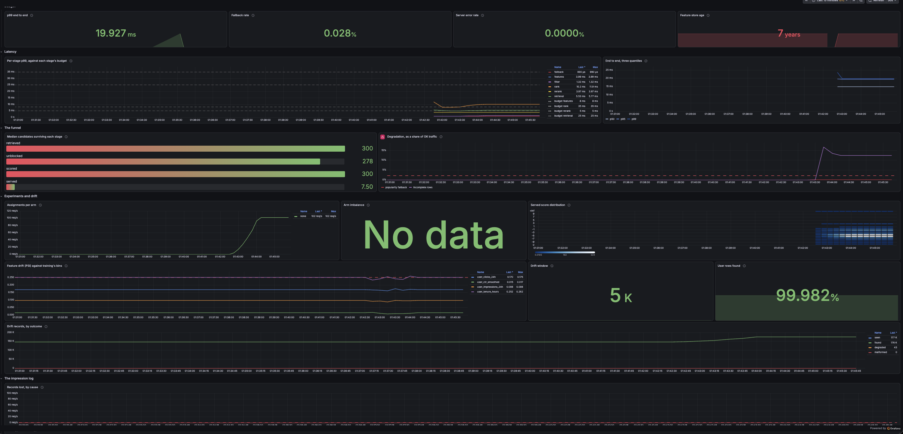
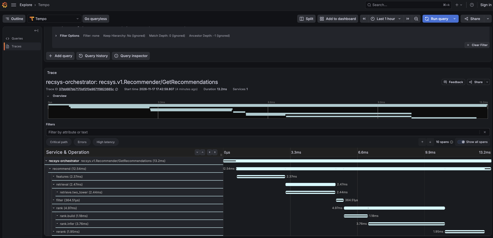

# Recommendation System Design

A multi-stage news recommender built end to end on [MIND](https://msnews.github.io/): a PySpark
medallion pipeline with point-in-time features, two-tower retrieval over a FAISS index, a ranker
served from Triton, and a Go orchestrator that assembles a slate inside a 90 ms budget — plus the
monitoring, experimentation and rollout machinery needed to decide whether a change should ship.

Where something is **not** built, it is named rather than left to be assumed: the fan-out is one
retriever against a design of five, nothing watches the guardrail alerts and rolls back, and no
model retrains on the log this system produces.

```bash
make up            # Kafka, Redis, MinIO, MLflow, Prometheus, Grafana, Tempo, Triton
make test          # contract and unit tests
```

**A fresh clone goes green without the dataset.** MIND is licence-gated, so no sampled rows may be
committed; the data contracts fall back to a seeded synthetic corpus of the same shape and build
bronze and silver from it *with the real pipeline*, so a parse bug still fails the build. With the
corpus and a GPU:

```bash
make data          # raw -> bronze -> silver -> gold   (make download first; gated)
make artifacts     # the artifacts the orchestrator and Triton read
make serve-all     # orchestrator + the two Python sidecars
make demo          # one request through the full path, printed
```

### The documents

Generated documents are rebuilt from the data they describe and are never hand-edited — a table
that disagrees with the JSON it quotes is worse than no table.

| | |
|---|---|
| [`design.md`](docs/design.md) | the funnel, the latency budget, failure modes, the feedback loop |
| [`evaluation.md`](docs/evaluation.md) | the protocol, cohort slicing, cold-start denominators |
| [`baselines.md`](docs/baselines.md) | every baseline's report card — *generated* |
| [`retrieval.md`](docs/retrieval.md) | the two-tower, scored over the full catalogue |
| [`ranking.md`](docs/ranking.md) | the ranker, its features and its ablations |
| [`benchmarks.md`](docs/benchmarks.md) | embedding tables, sequence pooling, the ANN index, the seen-list |
| [`rollout.md`](docs/rollout.md) | four rungs, and what is deliberately not automated |
| [`skew_report.md`](docs/skew_report.md) | training/serving skew — *generated* |
| [`exposure.md`](docs/exposure.md) | how much of the catalogue the policy reaches — *generated* |
| [`experiment.md`](docs/experiment.md) | a worked launch decision — *generated* |
| [`materialization_parity.md`](docs/materialization_parity.md) | Feast's online store against the offline one |
| [`adr/`](docs/adr) | thirteen decisions, each with the option it rejected and the downside accepted |


## The data pipeline

A medallion pipeline over [MIND-small](https://msnews.github.io/): `raw -> bronze -> silver -> gold`,
built with PySpark and driven by `make`. Every path, threshold and Spark setting comes from
`conf/config.yml`; nothing is hardcoded in the jobs.

```
raw/MIND/<split>/*.tsv          MIND as Microsoft ships it -- read-only
        |  make bronze
bronze/{events,history,news}/   typed Parquet, one row per item shown
bronze/{user_map,item_map}/     string ID -> contiguous int, global
        |  make silver
silver/impressions/<split>/     events + article metadata + integer indices
        |  make gold
gold/item_hourly_features/      point-in-time feature series for the feature store
```

```bash
make download          # fetch MIND from Hugging Face into paths.raw
make bronze            # raw  -> bronze     (rebuild: make bronze FORCE=1)
make silver            # bronze -> silver   (rebuild: make silver FORCE=1)
make gold              # silver -> gold     (rebuild: make gold  FORCE=1)
make data              # all four, in order
```

Each layer writes a Spark `_SUCCESS` marker on commit and skips itself if that marker is already
there, so `make data` is idempotent. A run that dies midway leaves no marker and is correctly
reported as unbuilt.

Counts below are for **MIND-small** with `SPLITS = train dev`.

---

### raw

MIND as downloaded, never regenerated by any job. Tab-separated, no header.

**Input:** the gated Hugging Face dataset `yjw1029/MIND` (the original Azure URLs return HTTP 409).
**Output:** `data/raw/MIND/<split>/`

`behaviors.tsv` -- one row per impression

| # | column | type | notes |
|---|---|---|---|
| 1 | `impression_id` | long | |
| 2 | `user_id` | string | `U12345` |
| 3 | `time` | string | `11/11/2019 9:05:58 AM` -- parsed with `MIND_TS_FORMAT` |
| 4 | `history` | string, nullable | space-separated item IDs clicked *before* this week |
| 5 | `impressions` | string | `N4-1 N5-0 N6-0`; `-1` clicked, `-0` not |

`news.tsv` -- one row per article

| # | column | type |
|---|---|---|
| 1 | `item_id` | string (`N45678`) |
| 2 | `category` | string |
| 3 | `subcategory` | string |
| 4 | `title` | string |
| 5 | `abstract` | string |
| 6 | `url` | string |
| 7 | `title_ents` | string (JSON) |
| 8 | `abstract_ents` | string (JSON) |

| split | behaviors rows | news rows |
|---|---|---|
| train | 156,965 | 51,282 |
| dev | 73,152 | 42,416 |

`entity_embedding.vec` and `relation_embedding.vec` also ship in the archive and are currently unused.

**Two properties of MIND that shape everything downstream.** Impression rows cover **one week**
(week five of the six-week collection); the first four weeks are compressed into the `history`
column, so the click log is far shorter than the collection window suggests. And Microsoft
**shuffles the impression list**, so item order carries no position-bias signal -- which is why the
exploded index is called `slot` and is never used as a position feature.

---

### bronze

Typed Parquet, one row per item shown. No filtering, no deduplication: bronze is raw with a schema.

**Input:** `data/raw/MIND/<split>/*.tsv`
**Command:** `make bronze` -> `data_pipeline/ingest/bronze.py`
**Output:** `data/bronze/`

`events/<split>/dt=YYYY-MM-DD/` -- the canonical event contract (`common/schemas.EVENT_SCHEMA`),
produced by `posexplode`-ing the impression list

| column | type | notes |
|---|---|---|
| `impression_id` | long | |
| `user_id` | string | |
| `ts` | timestamp | parsed from `time`, session timezone UTC |
| `slot` | int | index within the shuffled list; **not** a position feature |
| `item_id` | string | |
| `clicked` | boolean | observed, not sampled |
| `dt` | date | partition column, derived from `ts` |

`history/<split>/` -- kept unexploded on purpose; exploding it alongside the impressions multiplies
row count catastrophically

| column | type |
|---|---|
| `impression_id` | long |
| `user_id` | string |
| `history` | string (space-separated item IDs) |

`news/<split>/` -- `news.tsv` row for row, all 8 columns, unchanged.

`user_map/` and `item_map/` -- **global, not per split.** Built once from every split's events and
news, because an embedding table has one row space and a user appearing in both splits must get the
same index.

| table | columns | rows |
|---|---|---|
| `user_map` | `user_id` string, `user_idx` int | 94,057 |
| `item_map` | `item_id` string, `item_idx` int | 65,238 |

Indices are dense `0..n-1` via `row_number()`, never `monotonically_increasing_id()` -- that is
unique but not contiguous, and embedding tables are sized from `max(idx) + 1`.

| split | `events` rows | `history` rows | `news` rows |
|---|---|---|---|
| train | 5,843,444 | 156,965 | 51,282 |
| dev | 2,740,998 | 73,152 | 42,416 |

**32.9% of the items shown in dev never appear in train.** That number is the empirical case for a
content-based item tower: an ID-embedding-only model has nothing to say about a third of the
evaluation catalogue.

---

### silver

Bronze joined to article metadata and integer indices. Still lossless -- silver has exactly as many
rows as bronze `events`.

**Input:** `bronze/events/<split>`, `bronze/news/<split>`, `bronze/user_map`, `bronze/item_map`
**Command:** `make silver` -> `data_pipeline/transform/silver.py`
**Output:** `data/silver/impressions/<split>/dt=YYYY-MM-DD/`

| column | type | source |
|---|---|---|
| `impression_id` | long | events |
| `user_id` | string | events |
| `user_idx` | int | user_map |
| `item_id` | string | events |
| `item_idx` | int | item_map |
| `clicked` | boolean | events |
| `slot` | int | events |
| `ts` | timestamp | events |
| `dt` | date | partition column |
| `category` | string | news |
| `subcategory` | string | news |
| `title` | string | news |

| split | rows |
|---|---|
| train | 5,843,444 |
| dev | 2,740,998 |

Every join is `how="left"`, so an item missing from `news.tsv` would survive with null metadata
rather than vanishing. Measured: **zero rows** in either split are missing metadata, and that is
asserted as a contract rather than assumed.

**Splits live in separate directories, not in a `split` partition column.** MIND's train and dev are
distinct collection weeks, not a random division, and keeping them separate makes it impossible to
read the wrong one by forgetting a filter.

---

### gold

Three tables in two shapes: two point-in-time feature **series**, unioned across splits, and one
**label table per split** that joins into them. `asof_join` reads the series for training; Feast
materialises them to Redis for serving.

**Input:** `silver/impressions/<split>` for every split
**Command:** `make up && make gold` -> `data_pipeline/features/gold.py`
**Output:** the three series in MinIO, `training_examples/<split>` on disk

#### Where gold lives

This is the only layer with a storage backend. `storage.backend` in `conf/config.yml` is `s3`,
so **MinIO must be running** — `make up` starts it and creates the bucket.

| | Location | Why |
|---|---|---|
| the three feature series | `s3://recsys/gold/…` | Feast's sources; serving cannot read a laptop |
| `training_examples/<split>` | `data/gold/…` | largest table, read by the trainer on the same machine |

Two clients reach the same bucket by different routes, which is why the config carries a scheme:
Spark writes through Hadoop's S3A client (`s3a://`, magic committer), Feast reads through pyarrow
(`s3://`, `s3_endpoint_override`). `RECSYS_STORAGE__BACKEND=local` puts everything back on disk —
which is what the test fixtures do, so they need no container at all. `make demo` sets it too, so it
reads gold from disk rather than MinIO, but it still needs the **online** stack: Redis behind the
feature gateway and Triton behind the ranker.

Feast resolves these paths **at `feast apply` time** and bakes them into its registry, so running
`make feast` under a different backend than the one you built with produces a registry pointing at
data that is not there.

#### `item_hourly_features`

| column | type | notes |
|---|---|---|
| `item_id` | string | |
| `feature_ts` | timestamp | the hour the bucket **closed** -- see below |
| `item_impressions_1h` | long | impressions inside this bucket |
| `item_clicks_1h` | long | clicks inside this bucket |
| `item_impressions_24h` | long | rolling 24h `RANGE` window |
| `item_clicks_24h` | long | rolling 24h `RANGE` window |
| `item_age_hours` | double | hours since the item's earliest bucket |
| `category` | string | from news |
| `cat_expanding_ctr` | double | category CTR **as of this hour**, the shrinkage prior |
| `item_ctr_smoothed` | double | `(item_clicks_24h + prior*k) / (item_impressions_24h + k)`, `k = 20` -- 24h counts, **expanding** prior, so the horizons differ |

**Rows: 243,992** -- one per (item, hour) the item was actually shown in, not per (item, hour) in the
corpus.

**`feature_ts` is when a bucket CLOSED, not when it opened.** The row stamped 14:00 covers
`[13:00, 14:00)` and is therefore fully knowable at 14:00. This convention is what makes the `<=`
boundary in `asof_join` correct, and it mirrors what an hourly batch job can actually deliver
online. Stamping buckets with their start time instead would let a label at 14:23 read counts from
14:00-14:59 -- including its own impression. `test_hourly_features_do_not_leak_within_the_bucket`
guards exactly this.

**The series are not built per split.** Features belong to the timeline, not to a label. A train
label still cannot see dev-derived rows (dev's week follows train's, and the as-of join only reads
backwards), while a dev label *can* see train-derived rows -- which is correct, since the production
system serving that impression had those statistics. Building from train alone would leave every
dev-only item with null features.

#### `user_hourly_features`

The same construction on the other entity: one row per (user, hour the user was active), the same
close-stamped bucket, the same 24h `RANGE` frame. Separate table because the grain differs, and
separate timeline because `asof_join` reads each key independently.

| column | type | notes |
|---|---|---|
| `user_id` | string | |
| `feature_ts` | timestamp | the hour the bucket **closed** |
| `user_impressions_1h` / `user_clicks_1h` | long | inside this bucket |
| `user_impressions_24h` / `user_clicks_24h` | long | rolling 24h `RANGE` window |
| `user_tenure_hours` | double | hours since the user's earliest bucket |
| `user_ctr_smoothed` | double | shrunk toward the **global** as-of rate (0.0404 on train) |

Toward the global rate rather than a segment rate because MIND ships no demographics -- there is no
user cohort to regress a quiet reader toward, where an item at least has a category.

**Every column on both series is entity-prefixed.** Both land on the same label rows, so
`impressions_24h` unprefixed would collide on the second as-of join. `asof_join` raises on a column
collision rather than overwriting silently, but a name that cannot collide is better than an error
saying it did.

#### `training_examples/<split>`

Labels with the features that were knowable at their timestamp: silver's columns, plus the item
series joined on `item_id`, the user series on `user_id`, and the category prior on `category` --
three as-of joins over three independent timelines. Plus `hour_of_day` / `day_of_week` from `ts`,
and two cold-start flags.

**Rows: 5,837,182 (train) / 2,740,998 (dev).** Train is 6,262 short of silver: those labels fall in
the corpus's opening hour, before the first bucket closes anywhere, so neither the item nor the
category fallback has anything to offer. They are dropped rather than carried as nulls -- a label
whose features were entirely unknowable teaches a model nothing but the imputation rule. The count
is printed at build time so the loss is never silent.

**Cold-start is handled three ways, and the distinction matters.** The *rate* is imputed from the
category prior, because filling it with `0.0` would claim a measured click-through of zero -- a lie
about evidence, not a missing value. The *counts* are zero-filled, because zero is true: no bucket
had closed. And `has_item_features` / `has_user_features` record which happened, so a model can
learn that absence is itself a signal.

| | with item history | with user history |
|---|---|---|
| train | 99.2% | 67.2% |
| dev | 99.7% | **37.1%** |

**The user side is the sparse one, by a wide margin.** A user only has features once they have been
active in an *earlier closed hour*, and 88% of dev's users are new to the corpus in a split that
lasts a single day -- so most dev impressions carry no user history at all. Item coverage is near
total for the opposite reason: popular articles dominate impressions, so the cold item tail is wide
but thin (see `docs/evaluation.md`).

That asymmetry is a modelling constraint worth stating rather than discovering. A ranker leaning on
`user_ctr_smoothed` is leaning on a feature that is null for two dev impressions in three, which is
an argument for the content and context features carrying the cold case -- and for reporting metrics
sliced on `has_user_features`.

A user's first impression is **not** dropped and **not** imputed: it keeps real item features, so it
is a usable example, and dropping it would delete exactly the cold-start cohort the evaluation
harness slices on. Its `user_ctr_smoothed` stays null and the flag says why.

**The shrinkage prior is point-in-time too.** `cat_expanding_ctr` at hour *t* is the category's
click rate computed from buckets at or before *t*, never the whole corpus. Including bucket *t*
itself is legitimate under the closing-time convention above, and it removes a bootstrap hole at
hour zero. The prior sums `item_impressions_1h` / `item_clicks_1h` rather than the `_24h` columns, which
overlap between consecutive rows and would count the same click up to 24 times.

Both mattered, and both mattered most where the prior does its job. Against the whole-corpus
value, the as-of prior differs by 0.6% (finance) to 153% (movies) in the first hour, converging
within about a day; summing the rolling columns instead biased `kids` by -36.5%. A category below
1,000 cumulative impressions borrows the global rate, because in hour one `kids` has impressions
and zero clicks -- so its own prior is exactly `0.0`, and shrinking toward zero on no evidence is
worse than not shrinking.

**A rolling 24-hour prior is computed alongside it and deliberately not shipped.**
`category_prior()` returns both so the choice stays measurable; `cat_rolling_ctr` is dropped before
gold is written, so it is not in the table above and not in the FeatureView. Expanding won on
measurement: the two differ by 0.0070 absolute CTR on average, rolling is 1.7x noisier hour to
hour, and category CTR drifts only +0.8% from the first 36 hours to the last -- so rolling's
adaptivity buys nothing on a stationary corpus while costing noise on exactly the thin-sample
items the prior exists to serve.

---

### Invariants

Asserted in `data_pipeline/tests/test_contracts.py`; expectations are computed from the raw TSVs in
plain Python, never with Spark, so a shared parsing bug cannot cancel itself out.

| invariant | why |
|---|---|
| bronze `events` rows == impression tokens in `behaviors.tsv` | `posexplode` neither drops nor duplicates |
| silver rows == bronze `events` rows | the metadata joins must not fan out or filter |
| no null `user_idx` / `item_idx` in silver | a left join preserves row count even when it matches nothing |
| `dt=` partitions == distinct event dates | catches timezone drift |
| ID maps dense over `0..n-1` | embedding tables are sized from `max(idx) + 1` |
| CTR within `(0.01, 0.15)` | a label parse that silently inverts is otherwise undetectable |
| no feature visible from at or after its label | point-in-time correctness |

**No k-core or heavy-user filtering is applied.** The thresholds were measured before being
rejected: `min_item_impressions = 5` would remove 0.29% of train but **50.20% of dev**, because
dev's catalogue is largely new; `min_user_impressions = 3` would remove 75.46% of dev rows; and the
500-impression cap never binds, since the busiest user has 62 impressions. Dropping cold users and
long-tail items would inflate every reported metric by deleting the hardest cases. Zero-click
impressions are likewise **kept** -- a user shown five articles who wanted none is a real
observation, and carries most of the calibration signal.


## How results are measured

The current baseline numbers live in [docs/baselines.md](docs/baselines.md), rebuilt from the
report cards by `make results`; [docs/results.md](docs/results.md) indexes that alongside the
retrieval and cost documents. Every model in this project is scored by the same harness and
lands in one of those tables — including the ones that look good.

Two protocols, deliberately separate, because the same metric name over two different pools
is two different measurements — and the number alone does not say which you are looking at.

**Ranking is scored within the impression.** The items shown together in one page view were
selected by MSN's own recommender; the question is whether the model orders that slate
better than they did. This is MIND's leaderboard task, so GAUC, MRR and NDCG@10 reported
here are comparable to published MIND results.

**The baselines have only ever been measured as rankers.** `docs/baselines.md` reports the
popularity family, recency and co-visitation under the ranking protocol only. They are
retrieval-family models — candidate generators that can score any item — but they have only
ever been asked to reorder MSN's shortlist, so their `recall@10` is within-slate and says
nothing about whether they could retrieve from the catalogue. `evaluate_retrieval` is
implemented and tested and has still not been run against any of them.

**The two-tower retriever is measured, and measured separately.**
[`docs/retrieval.md`](docs/retrieval.md) scores it over the full catalogue on a 12-hour holdout
carved from train. No model appears in both documents, and no row of one is comparable to a row
of the other — different candidate set, different denominator, different question.

**Retrieval is scored against the whole catalogue** — all 65,238 articles, never a sampled
pool. Scoring one positive against ~100 random negatives is biased and does not
rank-correlate with full ranking ([Krichene & Rendle, 2020](https://dl.acm.org/doi/10.1145/3394486.3403226)),
and it yields a plausible-looking number with nothing in the output to reveal it. Any table
row labelled *retrieval* was produced over the full catalogue; `evaluate_retrieval` raises
rather than accept a short candidate pool.

Every per-impression metric is **undefined, not zero**, for a slate with no click, and every
aggregate carries the count it was taken over. MIND-small's dev impressions all carry a
click, so that count is zero overall — but a cohort slice can still reduce a slate to
all-clicks or all-misses, and a mean without its denominator is not a comparable number.

Full protocol, cohort slicing and the cold-start denominators: [`docs/evaluation.md`](docs/evaluation.md).


## Serving

A Go orchestrator on gRPC assembles a slate from three backends: a Feast gateway and a
FAISS + user-tower sidecar, both Python, and the ranker on Triton. Five stages against a 90 ms
end-to-end budget, each with its own deadline rather than a share of the request's.

```
features 8ms -> retrieval fan-out 25ms -> seen-list filter -> rank 35ms -> re-rank 5ms
```

Measured at 300 rps: **7 ms p50 across stages, 13.4 ms p99 end to end.** Saturation sits at
300–400 rps, and the binding constraint is not latency — p99 stays inside the budget at every
rate tested while the retriever starts missing its 25 ms deadline, so the slate falls back.
Full table and the regime it was measured in: [`docs/design.md`](docs/design.md).

**It degrades rather than failing, and that is the hard part to observe.** A failed feature
fetch serves a cold user, a failed retriever serves the union of the rest, a ranker that misses
its deadline ships the retrieval order, and an empty candidate set serves a precomputed
popularity slate. Every one returns `200` with a full slate — *faster* than a healthy request,
because it skipped the expensive stages. So a benchmark watching latency and status codes reports
a system that scales beautifully by not working; `make bench` reads the orchestrator's own
degradation counters before and after each rate for exactly that reason, and the first version of
it reported 10,000 rps for a service serving 97% fallbacks.

**Readiness does not track upstream health**, which inverts the obvious wiring. The pipeline
answers from `popular.json` with every backend down, so routing on backend health would flip every
pod out of the Service during a Triton outage and turn a degraded dependency into a total outage.
Three health names carry two meanings: liveness, readiness, and an `upstreams` verdict that
nothing routes on and dashboards read.

**Provenance travels with the response.** Triton reports the model version it served with and the
index sidecar reports its own in every health response, and those *win over* the command-line
flags — a static flag would drift from what actually served. Both land on the response, the
impression log, and the trace span.

Every served slate is logged to Kafka as protobuf with its propensities, which is what makes
off-policy evaluation possible at all — see below.


## Rollout

Four rungs — shadow, canary, A/B, ramp — in [`docs/rollout.md`](docs/rollout.md), with the
mechanism that carries each one and what is deliberately not automated.

**Shadow mode runs.** A second ranker scores the same feature matrix on live traffic, is served
never, and is logged into the impression record beside what actually served. Its column is
indicative rather than a measurement: the read is non-blocking, so which requests carry a shadow
score correlates with how hard they were.

**Assignment, the guardrails and the analysis are built; the actuator is not.** Variant
assignment is deterministic, sticky and salted per experiment, so a user cannot flip arms
mid-test and two experiments over the same users cannot share a split. Ten alerts in
`serving/monitoring/alerts.yml` are the canary's guardrails, and every dashboard threshold
mirrors one. Nothing watches them and rolls back, so a canary here is a human reading a
dashboard — `docs/rollout.md` says so rather than implying otherwise.

**A new model and a new binary need different mechanisms.** A new model is a variant inside the
running Deployment, where per-user assignment gives exactly the percent asked for. A new binary
needs a second Deployment, and a Kubernetes Service load-balances connections rather than
requests — a gRPC client multiplexes every call over one long-lived connection, so one canary pod
in ten receives whatever share of *clients* reached it, not 10% of traffic.


## Monitoring

Prometheus scrapes the orchestrator, Triton, the OTLP collector and the drift monitor; Grafana
provisions one dashboard from the repo, so it can be reviewed in a pull request rather than dying
with a volume. Every threshold on it mirrors a rule in `serving/monitoring/alerts.yml`, which is
what stops a green panel and a firing alert disagreeing.



Five stages against their budgets, the funnel in pipeline order, the four named degradations, arm
balance, and the feature-drift row — PSI per feature against **training's** bins, the rolling
window's size, user-found rate, and why a window is the size it is.

**Two panels are deliberately unflattering.** Feature-store age reads a multi-year gap, because
MIND's event timestamps are from 2019 and the clock is not; the panel's description says so rather
than hiding it, and §16.1's freshness alert is unenablable on this corpus for the same reason. And
the degradation panel is non-zero at the top of the `make bench` sweep, which is the point —
this pipeline degrades rather than failing, so a degraded request returns 200 with a full slate
*faster* than a healthy one. Latency alone cannot see it.

The drift monitor bins on the distribution the model was **fitted** on, never on a fresh quantile
of what is being served — edges that move with the data cannot detect the shift they exist to
detect. `docs/exposure.md` measures the related question of how much of the catalogue the policy
actually reaches.

### One request, end to end



OpenTelemetry spans from the orchestrator through the feature fetch, the retrieval fan-out, the
seen-list filter, ranking and re-ranking, tagged with the model and index version that served
them. The collector **tail-samples**: head sampling decides at the root, before anything worth
looking at has happened, so it discards degraded traces at exactly the same rate as healthy ones —
and degraded traces are rare by construction. Policies keyed on `recsys.degraded`,
`recsys.used_fallback`, `recsys.incomplete_rows`, error status and a 90 ms latency threshold keep
what matters, plus a small baseline of ordinary traffic so a broken request has something to be
read against.

**`rank` is two spans, not one.** `"ranker"` in the degradation label covers both a feature matrix
that failed to build and a Triton that did not answer; splitting `rank.build` from `rank.infer` is
what makes the waterfall say which — the only question worth asking when the rank stage has
consumed its entire 35 ms deadline.

⚠️ **The fan-out is narrower than the design.** `docs/design.md` §3 specifies five retrieval
sources; one is wired, so the trace shows a single `retrieve.two_tower` span rather than five
parallel ones. The span names are per-source, so the picture widens on its own when the others
land.


## Deciding whether to ship

A worked launch decision is in [`docs/experiment.md`](docs/experiment.md), regenerated by
`make simulate`. The responses are simulated; **the decision rule is not**, and the order it
applies is the part worth reading:

1. **Sample ratio mismatch, before the primary metric is even computed.** If assignment broke,
   every number below it describes the breakage. The live alert compares a 1.2 max/min ratio,
   which cannot tell a 20% imbalance over 200 assignments from the same imbalance over 200,000 —
   one is noise and the other is a serious defect. `evaluation/experiments/srm.py` runs the
   chi-square that can, at α=0.001 because a guard that fires on one healthy experiment in
   twenty gets switched off.
2. **Guardrails second.** A primary-metric win that costs latency or catalogue coverage is a
   trade, and the trade is named before the win is celebrated. A breach needs the *interval* to
   clear the tolerance, not just the point estimate, so a noisy guardrail cannot block a launch
   on its own noise.
3. **The primary metric as an interval**, de-noised by CUPED. An online experiment cannot pair
   users the way an offline comparison does — a user is in one arm or the other — so the
   between-user variance pairing would cancel has to be removed another way: by subtracting the
   part of each outcome a pre-experiment covariate already predicted.
4. **And if it is flat, the minimum detectable effect.** "Flat with adequate power" and "flat and
   underpowered" are different conclusions, and collapsing them is how a real effect ships as a
   null.

**Off-policy evaluation is built and deliberately not used there.**
`evaluation/counterfactual/ips.py` reweights the distribution over *which items are shown*; it
assumes the reward for a given (context, action) belongs to the world rather than to the policy.
A ranker that makes the shown items *more relevant* changes the reward function itself, which
importance weighting cannot see — so running it would produce a confident number for a quantity
it is not estimating. It applies cleanly to an action-distribution change, and that is where it
is pointed.

**How much of the catalogue the policy actually reaches** is a separate measurement:
[`docs/exposure.md`](docs/exposure.md), via `make exposure`. It found the serving policy reaching
**176 distinct articles** out of 65,238 — not because it was failing to personalise (19,983
requests produced 9,585 distinct orderings) but because the re-ranker's category cap and
exploration slots were configured, documented, and never applied. Wiring them widened reach
2.6×.

⚠️ **The simulator cannot falsify its own assumptions.** It encodes beliefs about how users
behave, so its numbers are statements about the model. Two are known to be wrong for this corpus
and kept anyway: MIND shuffles its impression lists, so the examination curve is imported rather
than measured, and the treatment lifts every user equally where a real one would not — which
makes **the power figures optimistic**. `docs/experiment.md` opens by saying so.
