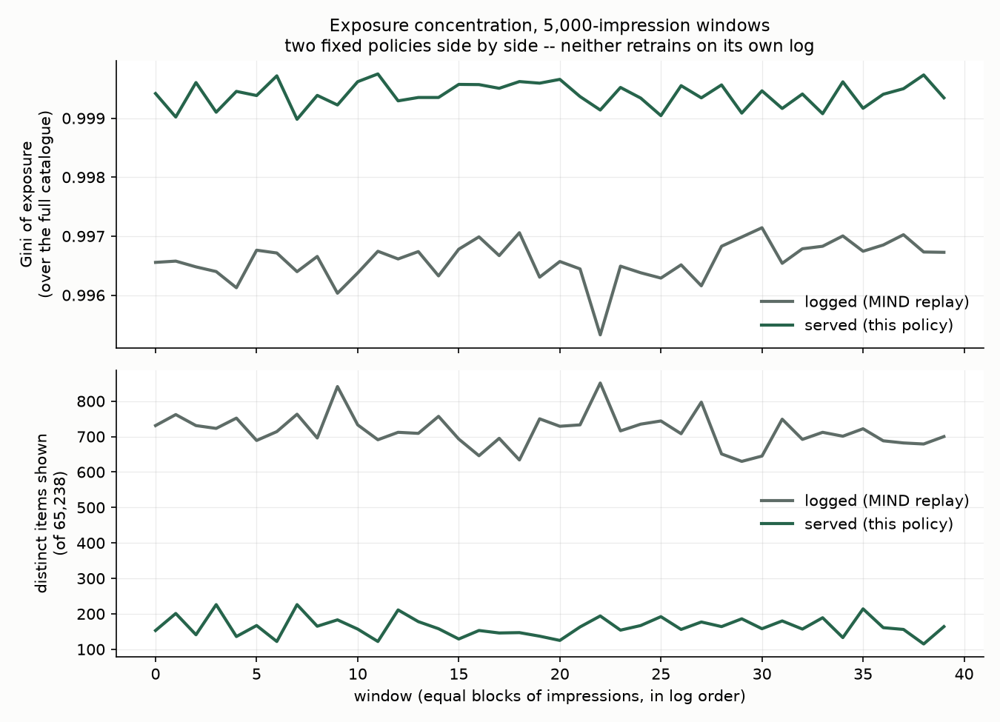

# Exposure concentration

How unevenly impressions are spread across the catalogue, measured in equal
blocks of impressions, for two policies side by side: MIND's own editorial
exposure as replayed, and the slates this orchestrator served.

Regenerate with `make exposure`. The block below is generated and must not be
hand-edited — a concentration figure that disagrees with the log it quotes is
worse than no figure. The prose outside it is hand-written and survives
regeneration.

## What the two curves can and cannot say

A **gap** between them is real and readable: it says this policy spreads
exposure differently from the log it was trained on, in a direction and by an
amount the table gives.

A **slope** is not a feedback loop. Both policies are fixed for the whole
measurement — nothing here retrains on the served log — so the served curve
drifting is sampling, catalogue churn, or the seen-list filter doing its job,
not a loop tightening. Observing an actual loop needs the served log fed back
into training and the measurement repeated per generation, which
[docs/design.md §8](design.md) describes and this repo does not do.

This measurement has already earned its place once: the first run found the
reranker's category cap and exploration slots inert, because four flags were
parsed and never assigned. Reach went from 62 distinct items per window to 164
when they were wired through. [docs/design.md §8](design.md) has the account.

Read the two Gini columns together. Gini over the **catalogue** falls as
coverage rises, so it mixes "how many items were shown" with "how evenly";
Gini over the **observed** items holds coverage fixed. Showing fewer things and
showing the same things more often are different failures, and only the pair
distinguishes them.

<!-- exposure:begin -->

**logged (MIND replay)**: 200,000 impressions, 40 full windows of 5,000.
**served (this policy)**: 200,000 impressions, 40 full windows of 5,000.

| Policy | Window | Impressions | Distinct items | Gini (catalogue) | Gini (observed) |
|---|---:|---:|---:|---:|---:|
| logged (MIND replay) | 0 | 5,000 | 731 | 0.9966 | 0.6926 |
| logged (MIND replay) | 1 | 5,000 | 762 | 0.9966 | 0.7069 |
| logged (MIND replay) | 2 | 5,000 | 731 | 0.9965 | 0.6858 |
| logged (MIND replay) | 3 | 5,000 | 723 | 0.9964 | 0.6751 |
| logged (MIND replay) | 4 | 5,000 | 752 | 0.9961 | 0.6639 |
| logged (MIND replay) | 5 | 5,000 | 689 | 0.9968 | 0.6934 |
| logged (MIND replay) | 6 | 5,000 | 714 | 0.9967 | 0.6998 |
| logged (MIND replay) | 7 | 5,000 | 763 | 0.9964 | 0.6920 |
| logged (MIND replay) | 8 | 5,000 | 696 | 0.9967 | 0.6865 |
| logged (MIND replay) | 9 | 5,000 | 841 | 0.9960 | 0.6922 |
| logged (MIND replay) | 10 | 5,000 | 733 | 0.9964 | 0.6775 |
| logged (MIND replay) | 11 | 5,000 | 691 | 0.9967 | 0.6926 |
| logged (MIND replay) | 12 | 5,000 | 712 | 0.9966 | 0.6897 |
| logged (MIND replay) | 13 | 5,000 | 709 | 0.9967 | 0.6999 |
| logged (MIND replay) | 14 | 5,000 | 757 | 0.9963 | 0.6834 |
| logged (MIND replay) | 15 | 5,000 | 693 | 0.9968 | 0.6968 |
| logged (MIND replay) | 16 | 5,000 | 646 | 0.9970 | 0.6958 |
| logged (MIND replay) | 17 | 5,000 | 695 | 0.9967 | 0.6874 |
| logged (MIND replay) | 18 | 5,000 | 634 | 0.9971 | 0.6973 |
| logged (MIND replay) | 19 | 5,000 | 750 | 0.9963 | 0.6785 |
| logged (MIND replay) | 20 | 5,000 | 729 | 0.9966 | 0.6931 |
| logged (MIND replay) | 21 | 5,000 | 733 | 0.9964 | 0.6836 |
| logged (MIND replay) | 22 | 5,000 | 851 | 0.9953 | 0.6417 |
| logged (MIND replay) | 23 | 5,000 | 716 | 0.9965 | 0.6803 |
| logged (MIND replay) | 24 | 5,000 | 735 | 0.9964 | 0.6786 |
| logged (MIND replay) | 25 | 5,000 | 744 | 0.9963 | 0.6746 |
| logged (MIND replay) | 26 | 5,000 | 708 | 0.9965 | 0.6787 |
| logged (MIND replay) | 27 | 5,000 | 797 | 0.9962 | 0.6855 |
| logged (MIND replay) | 28 | 5,000 | 651 | 0.9968 | 0.6822 |
| logged (MIND replay) | 29 | 5,000 | 630 | 0.9970 | 0.6878 |
| logged (MIND replay) | 30 | 5,000 | 645 | 0.9971 | 0.7110 |
| logged (MIND replay) | 31 | 5,000 | 749 | 0.9965 | 0.6986 |
| logged (MIND replay) | 32 | 5,000 | 692 | 0.9968 | 0.6970 |
| logged (MIND replay) | 33 | 5,000 | 712 | 0.9968 | 0.7094 |
| logged (MIND replay) | 34 | 5,000 | 701 | 0.9970 | 0.7211 |
| logged (MIND replay) | 35 | 5,000 | 722 | 0.9967 | 0.7058 |
| logged (MIND replay) | 36 | 5,000 | 688 | 0.9969 | 0.7013 |
| logged (MIND replay) | 37 | 5,000 | 682 | 0.9970 | 0.7154 |
| logged (MIND replay) | 38 | 5,000 | 679 | 0.9967 | 0.6859 |
| logged (MIND replay) | 39 | 5,000 | 700 | 0.9967 | 0.6949 |
| served (this policy) | 0 | 5,000 | 153 | 0.9994 | 0.7518 |
| served (this policy) | 1 | 5,000 | 201 | 0.9990 | 0.6819 |
| served (this policy) | 2 | 5,000 | 141 | 0.9996 | 0.8170 |
| served (this policy) | 3 | 5,000 | 226 | 0.9991 | 0.7405 |
| served (this policy) | 4 | 5,000 | 136 | 0.9995 | 0.7383 |
| served (this policy) | 5 | 5,000 | 167 | 0.9994 | 0.7594 |
| served (this policy) | 6 | 5,000 | 122 | 0.9997 | 0.8493 |
| served (this policy) | 7 | 5,000 | 226 | 0.9990 | 0.7058 |
| served (this policy) | 8 | 5,000 | 165 | 0.9994 | 0.7575 |
| served (this policy) | 9 | 5,000 | 183 | 0.9992 | 0.7234 |
| served (this policy) | 10 | 5,000 | 157 | 0.9996 | 0.8416 |
| served (this policy) | 11 | 5,000 | 122 | 0.9998 | 0.8665 |
| served (this policy) | 12 | 5,000 | 211 | 0.9993 | 0.7817 |
| served (this policy) | 13 | 5,000 | 178 | 0.9994 | 0.7621 |
| served (this policy) | 14 | 5,000 | 158 | 0.9994 | 0.7321 |
| served (this policy) | 15 | 5,000 | 129 | 0.9996 | 0.7840 |
| served (this policy) | 16 | 5,000 | 153 | 0.9996 | 0.8164 |
| served (this policy) | 17 | 5,000 | 146 | 0.9995 | 0.7796 |
| served (this policy) | 18 | 5,000 | 147 | 0.9996 | 0.8318 |
| served (this policy) | 19 | 5,000 | 137 | 0.9996 | 0.8064 |
| served (this policy) | 20 | 5,000 | 125 | 0.9997 | 0.8215 |
| served (this policy) | 21 | 5,000 | 163 | 0.9994 | 0.7465 |
| served (this policy) | 22 | 5,000 | 194 | 0.9991 | 0.7102 |
| served (this policy) | 23 | 5,000 | 154 | 0.9995 | 0.7972 |
| served (this policy) | 24 | 5,000 | 167 | 0.9993 | 0.7426 |
| served (this policy) | 25 | 5,000 | 192 | 0.9990 | 0.6749 |
| served (this policy) | 26 | 5,000 | 156 | 0.9996 | 0.8124 |
| served (this policy) | 27 | 5,000 | 177 | 0.9993 | 0.7585 |
| served (this policy) | 28 | 5,000 | 164 | 0.9996 | 0.8266 |
| served (this policy) | 29 | 5,000 | 186 | 0.9991 | 0.6794 |
| served (this policy) | 30 | 5,000 | 158 | 0.9995 | 0.7786 |
| served (this policy) | 31 | 5,000 | 180 | 0.9992 | 0.6972 |
| served (this policy) | 32 | 5,000 | 157 | 0.9994 | 0.7548 |
| served (this policy) | 33 | 5,000 | 189 | 0.9991 | 0.6810 |
| served (this policy) | 34 | 5,000 | 133 | 0.9996 | 0.8120 |
| served (this policy) | 35 | 5,000 | 214 | 0.9992 | 0.7463 |
| served (this policy) | 36 | 5,000 | 161 | 0.9994 | 0.7591 |
| served (this policy) | 37 | 5,000 | 156 | 0.9995 | 0.7908 |
| served (this policy) | 38 | 5,000 | 115 | 0.9997 | 0.8485 |
| served (this policy) | 39 | 5,000 | 164 | 0.9993 | 0.7396 |

Catalogue: 65,238 items. Gini (catalogue) counts every item that could have been shown, so it falls as coverage rises; Gini (observed) holds coverage fixed and reports only how evenly the shown items shared the exposure. Reading them together is what separates *showing fewer things* from *showing the same things more often*.

_Generated 2026-11-17T23:42:10+00:00 from `325328a7ee65`, over `/tmp/logged.jsonl` and `/tmp/served.jsonl`._
<!-- exposure:end -->
